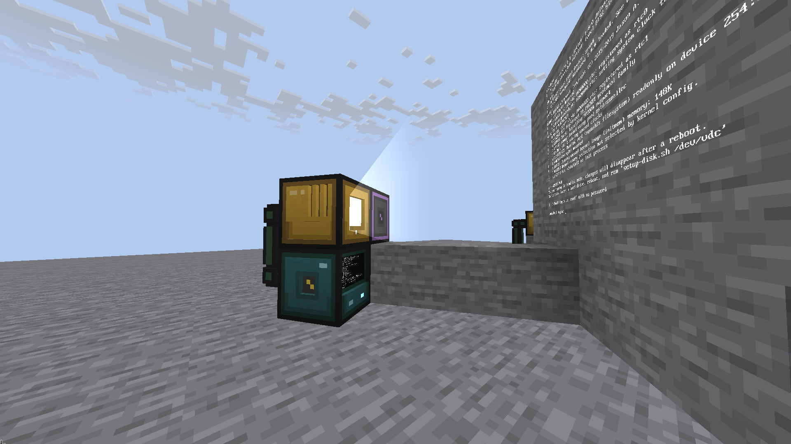

<div align="center">

# OpenComputers II: Modern

Programmable computers, Linux, and robots inside Minecraft.


[Downloads](https://github.com/DivByDiamond/OC2R/releases) · [Wiki](https://wiki.loki-code.dev/ru/item/index) · [Report a bug](https://github.com/DivByDiamond/OC2R/issues)

[English](#english) | [Русский](#русский)

</div>



## English

### What is OC2R?

**OpenComputers II: Modern (OC2R)** brings programmable computers and robots to Minecraft. Boot Linux, write Lua programs to control devices, connect machines over a network, and build displays with monitors and projectors.

Each computer runs a 64-bit RISC-V virtual machine powered by [Sedna]. The Linux image and Lua runtime are bundled with the mod, so you can start programming without downloading an operating system.

### Features

- **Programmable automation:** access redstone, inventories, and other exposed devices through the high-level Lua API.
- **Modular hardware:** choose CPUs, RAM, firmware, storage, and expansion cards for each computer.
- **Displays and sound:** use tiered GPUs and monitors, project images onto the world, and play tones or PCM audio through a speaker.
- **Networking:** connect computers with network cards and cables; use an Internet Card for guest network access, subject to server configuration.
- **Programmable robots:** run programs on mobile machines that can interact with the world.
- **Terminal:** ANSI colors, cursor control, scroll regions, Unicode text, and a built-in computer terminal that works without a GPU.
- **Saved VM state:** CPU, RAM, and device state persist across world reloads.
- **Built-in manual:** English and Russian guides cover hardware, programming, and networking.
- **Custom operating systems and addons:** experiment with [OnyxOS], or add virtual devices through the Java API.

### Supported versions

| Minecraft | Loader | Java |
|-----------|--------|------|
| 1.21.1 | NeoForge | 21 |
| 1.21.1 | Fabric | 21 |
| 26.1.2 | NeoForge | 25 |
| 26.1.2 | Fabric | 25 |
| 26.2 | NeoForge | 25 |
| 26.2 | Fabric | 25 |

Fabric 26.1.2/26.2 is implemented and passed local server/client acceptance on 2026-10-24; CI confirmation and publication are tracked separately in the [acceptance report](docs/roadmap/fabric-26-acceptance.md). Check the release assets for available downloads and choose the file matching your Minecraft version and loader. All Fabric versions require **Fabric API**; Team Reborn Energy and Forge Config API Port are bundled.

### Getting started

1. Install the matching OC2R JAR in your `mods/` folder, along with Fabric API if using Fabric.
2. Craft and place a computer. Prepare a CPU and RAM; four 8 MiB memory modules (32 MiB total) are a practical starting configuration.
3. Right-click with a scrench to open the component inventory. Install the CPU, RAM, and Linux firmware. The survival computer recipe includes the firmware chip; computers obtained another way may need one added separately.
4. Supply energy, then right-click the front of the computer with an empty hand to open the terminal. Press its power button, wait for the login prompt, and log in as `root`. Shift + right-click with an empty hand also starts the computer.
5. Use the built-in manual to explore scripting and devices. An extra hard drive and GPU are not required for the default Linux boot and built-in terminal.

For an external monitor, add a GPU, connect the display through bus interfaces and bus cables, and supply power to the display.

From the Lua interpreter, a connected Redstone Interface can be controlled with:

```lua
require("devices"):find("redstone"):setRedstoneOutput("up", 15)
```

See the [wiki item guide](https://wiki.loki-code.dev/ru/item/index) (Russian) and the [quickstart guide](src/main/resources/assets/oc2r/doc/en_us/getting_started.md).

### Create compatibility

OC2R includes compatibility handling for **Create** and **Create: Aeronautics**, including computers on moving contraptions. Availability depends on the Minecraft, loader, and integration versions; check the relevant release notes when assembling a modpack.

### For server owners

Each running computer emulates a real machine and consumes host CPU time and memory. Size guest RAM and the number of active computers to suit your server, and review the energy and Internet Card settings before opening the server to players.

## Русский

### Что такое OC2R?

**OpenComputers II: Modern (OC2R)** добавляет в Minecraft программируемые компьютеры и роботов. Загружайте Linux, управляйте устройствами через Lua, объединяйте машины в сеть и создавайте экраны с мониторами и проекторами.

Каждый компьютер работает на 64-битной виртуальной машине RISC-V на базе [Sedna]. Linux и среда Lua уже входят в мод: отдельно скачивать операционную систему не требуется.

### Возможности

- **Автоматизация:** управляйте редстоуном, инвентарями и другими доступными устройствами через высокоуровневый Lua API.
- **Модульное железо:** выбирайте процессоры, память, прошивки, накопители и платы расширения.
- **Изображение и звук:** используйте видеокарты разных уровней и мониторы, проецируйте изображение на мир, воспроизводите тоны и PCM-аудио через динамик.
- **Сети:** соединяйте компьютеры сетевыми картами и кабелями; Internet Card даёт гостевой системе доступ к сети в пределах настроек сервера.
- **Программируемые роботы:** запускайте программы на мобильных машинах, взаимодействующих с миром.
- **Терминал:** ANSI-цвета, управление курсором, области прокрутки, Unicode и встроенный экран компьютера, работающий без видеокарты.
- **Сохранение состояния ВМ:** процессор, оперативная память и устройства сохраняют состояние между загрузками мира.
- **Встроенное руководство:** инструкции по железу, программированию и сетям на русском и английском.
- **Свои ОС и аддоны:** экспериментируйте с [OnyxOS] или добавляйте виртуальные устройства через Java API.

### Поддерживаемые версии

| Minecraft | Загрузчик | Java |
|-----------|-----------|------|
| 1.21.1 | NeoForge | 21 |
| 1.21.1 | Fabric | 21 |
| 26.1.2 | NeoForge | 25 |
| 26.1.2 | Fabric | 25 |
| 26.2 | NeoForge | 25 |
| 26.2 | Fabric | 25 |

Fabric 26.1.2/26.2 реализован и прошёл локальную серверную и клиентскую приёмку 24 октября 2026 года; подтверждение CI и публикация отслеживаются отдельно в [отчёте приёмки](docs/roadmap/fabric-26-acceptance.md). Доступные файлы смотрите в релизах и выбирайте сборку для своей версии Minecraft и загрузчика. Для всех версий Fabric нужен **Fabric API**; Team Reborn Energy и Forge Config API Port уже включены в сборку.

### Быстрый старт

1. Поместите подходящий JAR OC2R в папку `mods/`. Для Fabric также установите Fabric API.
2. Скрафтите и поставьте компьютер. Подготовьте процессор и оперативную память; для начала подойдут четыре модуля по 8 МиБ (32 МиБ суммарно).
3. Откройте инвентарь компонентов ПКМ с ключом и установите процессор, память и Linux-прошивку. Рецепт компьютера в выживании включает чип прошивки; при получении компьютера другим способом его может потребоваться добавить отдельно.
4. Подайте питание и откройте терминал ПКМ пустой рукой по передней стороне компьютера. Нажмите кнопку питания, дождитесь приглашения входа и войдите как `root`. Shift + ПКМ пустой рукой также запускает компьютер.
5. Откройте встроенное руководство, чтобы освоить программирование и устройства. Для стандартного Linux и встроенного терминала отдельный жёсткий диск и видеокарта не нужны.

Для внешнего монитора установите видеокарту, подключите экран через шинные интерфейсы и кабели, затем подайте питание на экран.

В интерпретаторе Lua подключённым редстоун-интерфейсом можно управлять так:

```lua
require("devices"):find("redstone"):setRedstoneOutput("up", 15)
```

Подробнее: [предметы и устройства на вики](https://wiki.loki-code.dev/ru/item/index) и [быстрый старт](src/main/resources/assets/oc2r/doc/ru_ru/getting_started.md).

### Совместимость с Create

В OC2R предусмотрена совместимость с **Create** и **Create: Aeronautics**, включая компьютеры на движущихся конструкциях. Доступность зависит от версий Minecraft, загрузчика и интеграции; при сборке модпака сверяйтесь с примечаниями к релизам.

### Владельцам серверов

Каждый работающий компьютер эмулирует отдельную машину и использует процессорное время и память хоста. Подбирайте объём гостевой RAM и количество активных компьютеров под ресурсы сервера, а перед открытием сервера проверьте настройки энергии и Internet Card.

## Project and credits

OC2R continues [North-Western-Development/OC2R], a fork of Sangar's [OpenComputers 2], the spiritual successor to OpenComputers. This is an independent continuation, not an official OpenComputers project.

Maintained by [TumRedSun](https://github.com/TumRedSun), [loki5512344](https://codeberg.org/loki5512344), and contributors. Thanks to [pocketprobe](https://github.com/pocketprobe) for upstream bug fixes.

The mod builds on [Sedna], [Ceres], [Minux], [OC2R Native Networking], and vendored [jcodec].

---

## Development

### Building

Run Gradle with Java 25 and keep a Java 21 toolchain installed for Minecraft 1.21.1. Loom 1.18 requires Java 25 even when selecting a legacy target.

The build multiplexes Minecraft versions through [Stonecutter](https://stonecutter.kikugie.dev/); the working tree is kept on the `1.21.1` node. Modules: the root project (NeoForge), `core` (loader-independent code) and `fabric`.

```bash
./gradlew :1.21.1:build :fabric:1.21.1:build   # NeoForge + Fabric on 1.21.1
./gradlew :1.21.1:gameTest                     # NeoForge GameTests
./gradlew :fabric:1.21.1:runGameTest           # Fabric GameTests
./gradlew :26.1.2:assemble :26.2:assemble     # NeoForge on 26.x (Java 25)
bash scripts/verify-stage3.sh --console=plain # Original four-target acceptance matrix
bash scripts/verify-fabric-26.sh --console=plain # Fabric 26.x assembly/server/client acceptance
```

Switch the sources to another version with `./gradlew "Set active project to 26.1.2"` and reset with `./gradlew "Reset active project"` before committing.

### Docs

- [Source Structure](docs/SRC_STRUCTURE.md)
- [Architecture](docs/ARCHITECTURE.md)
- [Multiloader / multiversion](docs/MULTILOADER.md)
- [Roadmap](docs/roadmap/README.md)
- [Contributing](CONTRIBUTING.md)

### License

GNU General Public License v3.0. See [LICENSE](LICENSE).

[North-Western-Development/OC2R]: https://github.com/North-Western-Development/OC2R
[OpenComputers 2]: https://github.com/fnuecke/oc2
[Sedna]: https://github.com/North-Western-Development/sedna
[Sedna upstream]: https://github.com/fnuecke/sedna
[Ceres]: https://github.com/fnuecke/ceres
[Minux]: https://github.com/North-Western-Development/minux
[OC2R Native Networking]: https://github.com/North-Western-Development/oc2r-native-networking
[jcodec]: https://github.com/jcodec/jcodec
[OnyxOS]: https://github.com/loki5512344/OnyxOS
